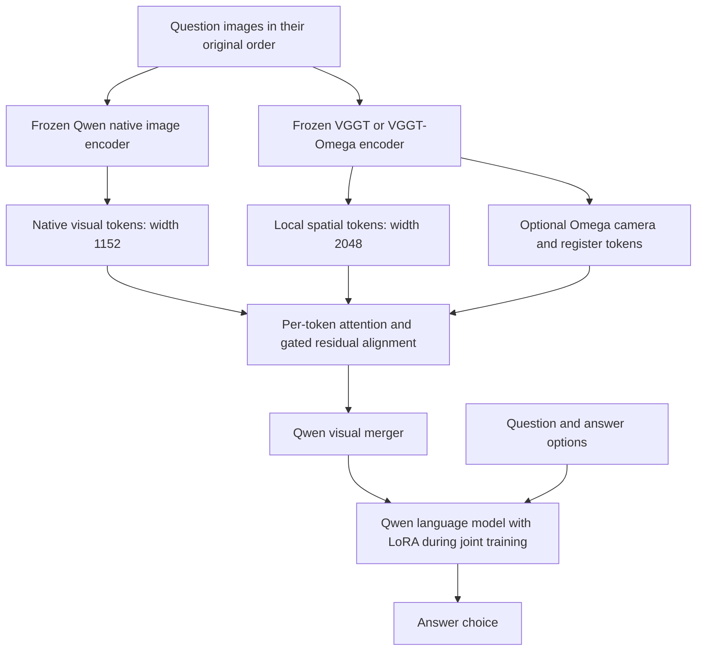

# Frozen Spatial Encoder Alignment: Experiment Idea, Design, and Scale

**Completed October 26: full training finished at 03:35 and corrected final evaluation finished at 09:42. Verified results are 48.99% OmniSpatial accuracy on all 1,533 questions, 74.33% SAT rotation-mean accuracy, and 65.33% SAT strict consistency. Initial test-preparation coverage/ID errors were corrected and their invalid scores archived. The final checkpoint was unchanged. See the completed study and updated meeting brief for current results.**

Prepared on 2026-10-25, Singapore time; updated for the user's permanent single-seed instruction and subsequent request to train and test only the final paper model first. This document describes the implemented V2 experiment, completed pilot comparisons, and the completed primary full-training and test run.

Historical execution check at 23:14 Singapore time: job 8834 was training on two B300 GPUs with 128 CPUs and 512 GiB host RAM. It resumed update 8,100 and saved a new two-rank checkpoint at update 8,200, including optimizer and RNG state. That training job subsequently completed all 24,904 updates. Historical external cancellations remain recorded in the audit; no further training is scheduled.

## 1. Experiment in brief

The experiment asks whether a pretrained spatial encoder can improve a vision-language model's spatial reasoning when its features are connected to the model through a small, trainable alignment module. The common vision-language backbone is the locally available **Qwen3.5-9B**. The auxiliary spatial feature sources are **VGGT-1B** and **VGGT-Ω**.

Both the native image encoder and the auxiliary spatial encoder remain frozen. The alignment module lets native visual tokens attend to spatial features and adds the resulting correction before Qwen's existing visual merger. Training uses spatial multiple-choice question answering and includes language-model LoRA adaptation in the joint stage.

The completed experiment trained **O2, the proposed local Ω alignment plus scene-context model**, on **168,520 unique training-side questions**, using **one fixed seed (42)**. It makes four passes with dataset replay, totaling **796,844 question exposures and 24,904 optimizer updates**. B1, G1, and O1 comparisons are deferred until requested. The final model's training, testing, and report do not wait for those ablations. The model is configured and verified for **two B300 GPUs in data parallel**, continuing its existing checkpoint after explicit user authorization. Repeated training across multiple seeds is prohibited by user instruction.

Here, a full refit means training the declared adapters and merger through the complete dataset and schedule. The experiment does not update every parameter of the 9B backbone.

## 2. Research idea and hypotheses

A native vision-language model already has useful image and language representations. A spatial encoder may provide complementary features describing layout, relative position, camera context, and relations across views. Those features need an interface that preserves the native model's useful behavior while learning which spatial information helps answer questions.

The proposed interface learns a residual correction to each native visual token:

```text
aligned_visual_tokens = native_visual_tokens
                      + gated_local_spatial_correction
                      + optional_gated_scene_correction
```

The output projections of the new correction branches start at zero. Consequently, adding the module initially preserves the native visual tokens exactly. Small learned channel gates regulate the corrections as training proceeds.

The main hypotheses are:

1. Learned alignment of frozen spatial features improves spatial QA over a native adaptation baseline trained on the same data.
2. Ω features improve on ordinary VGGT features when both use the same local alignment architecture.
3. A separate scene branch provides information beyond local spatial features.

The alignment is learned from answer supervision. The implemented objective has no separate depth, camera-pose, reconstruction, contrastive, or feature-distillation loss. Camera and scene tokens are learned encoder features; the system does not explicitly reconstruct a 3D scene during QA.

## 3. Relationship to the original proposal

The original proposal concerned VLM-3R, video inputs, and replacing its CUT3R feature source with VGGT-Ω. At the user's request, the implemented study changed the backbone to Qwen3.5-9B and moved to available spatial-understanding QA datasets while retaining frozen spatial encoder alignment.

The current study therefore evaluates the alignment idea in a revised setting. It uses individual images, composite images, and ordered sequences of up to four images. It does not implement the original 32-frame video recipe or a CUT3R comparison.

An earlier OmniSpatial-only study, V1, found that its scene-fusion implementation learned worse than the native baseline. V2 responds with more training data, a shared adapted starting point, exact native-path preservation at initialization, normalized attention modules, and a scene correction computed separately for each native token. V1 and V2 also use different scoring protocols, so their scores do not form a controlled before/after comparison.

## 4. Model architecture



### Native and auxiliary feature extraction

- **Native path:** cache Qwen features immediately before the visual merger; each native token has width 1,152. The normal visual-token order and merger interface are preserved.
- **Spatial path:** strictly load the pretrained spatial checkpoint and retain its frozen aggregator. For a question with multiple images, process all its images together in one ordered encoder forward pass. This allows spatial features to incorporate context from the other supplied images.
- **Input preparation:** preserve the complete auxiliary image with square padding. Ω uses 416 × 416 inputs; VGGT uses 518 × 518. Padding masks exclude empty padded regions during spatial grid pooling.
- **Caching:** native features are cached per image; auxiliary features are cached per ordered image sequence. This avoids repeatedly running frozen encoders during optimization.

### Local alignment branch

Each supplied image has a local auxiliary sequence of **197 tokens**: a pooled 14 × 14 spatial grid plus one camera token, all with width 2,048. Native and auxiliary features are normalized and projected to an attention width of **512**. Eight-head cross-attention uses native visual tokens as queries and spatial tokens as keys and values. A projected, gated correction is added to each native token.

G1 and O1 use exactly the same local module architecture. The new branch has **3,290,624 trainable parameters**. It preserves the number of visual tokens sent to the language model.

### Optional scene branch

O2 additionally uses Ω's **17 prefix tokens per image**, consisting of one camera token and 16 register tokens. A normalized transformer block processes them, and a second cross-attention produces a scene correction for each native token. This branch has its own zero-initialized output projection and gate.

O2's complete alignment module has **8,092,416 parameters**, or 4,801,792 more than O1. An O2-versus-O1 gain would therefore reflect the scene branch and its added capacity together.

## 5. Compared models and trainable scale

All four trained arms begin from the same existing native-model checkpoint: the V1 B1 seed-42 pilot checkpoint at epoch 4. This checkpoint contains a previously adapted visual merger and language LoRA weights. The new spatial modules start from their own identity-preserving initialization. Full refits restart from this common checkpoint; they do not continue the V2 pilot models.

| Arm | Model | Auxiliary features | Alignment parameters | Total trainable parameters in joint stage |
|---|---|---|---:|---:|
| B1 | Native adaptation baseline | None | 0 | 55,061,248 |
| G1 | Local VGGT alignment | Local grid + camera | 3,290,624 | 58,351,872 |
| O1 | Local Ω alignment | Local grid + camera | 3,290,624 | 58,351,872 |
| O2 | Local Ω alignment + scene context | Local grid + camera + registers | 8,092,416 | 63,153,664 |

The shared trainable components in the joint stage are the **40,119,040-parameter visual merger** and **14,942,208 language LoRA parameters**. Counts above were read from the saved V2 pilot checkpoint tensors.

LoRA has rank 16, alpha 32, and dropout 0.05. It targets 104 linear modules in Qwen's hybrid language architecture: 24 each of `linear_attn.out_proj`, `linear_attn.in_proj_qkv`, and `linear_attn.in_proj_z`, plus eight each of `q_proj`, `k_proj`, `v_proj`, and `o_proj` in full-attention layers. Embeddings, the language output head, and other base language weights remain frozen.

Two additional fixed models are defined for a later comparison:

- **R0:** the original pretrained Qwen3.5-9B, before the shared adaptation.
- **W0:** the shared adapted starting checkpoint, before V2 training.

These controls would distinguish the effect of the common starting checkpoint, additional native adaptation, and spatial alignment. G1 versus O1 is the most direct same-adapter comparison between the two spatial feature sources. Their source checkpoints and native auxiliary resolutions differ, which limits attribution to any single encoder design choice. Only O2 received the completed full refit and final test evaluation; other full-data controls remain deferred.

## 6. Datasets and preparation

The dataset mixture combines **SAT-v2**, **OmniSpatial**, and **MindCube**. SAT contributes spatial action and perspective questions; OmniSpatial provides the target benchmark's training questions; MindCube adds questions over ordered scene views and spatial relations.

### Partitions used before the design was locked

| Partition | SAT | OmniSpatial | MindCube | Total unique questions |
|---|---:|---:|---:|---:|
| Training pool | 147,622 | 5,172 | 9,019 | 161,813 |
| Development | 2,069 | 1,032 | 570 | 3,671 |
| Confirmation | 1,932 | 693 | 411 | 3,036 |
| **Full refit after lock** | **151,623** | **6,897** | **10,000** | **168,520** |

Pilot training samples **12,000 unique questions** from the training pool: 8,000 SAT, 2,000 OmniSpatial, and 2,000 MindCube. Pilot checkpoint selection uses a fixed **1,280-question development subset**: 512 SAT, 512 OmniSpatial, and 256 MindCube. Confirmation uses all 3,036 confirmation questions.

After the shared epoch count and confirmation results are recorded, the full refits combine the training, development, and confirmation partitions. Thus development and confirmation are held out for the pilot comparison, but they are subsequently training data for the full refits. Their pilot scores cannot be reused as independent validation of the full models. Final evaluation uses separate benchmark test sets.

### Preparation and isolation

- The raw SAT training parquet contains 172,384 rows. Preparation excludes 24,732 records with invalid or unsupported choice metadata and 30 training rows overlapping held-out image components, leaving 147,622 SAT training-pool questions.
- Decode images to a common RGB representation for content hashing. Keep connected image components in the same partition, and additionally group MindCube examples by source scene directory.
- Remove exact repeated question/image/answer records. The cleaned OmniSpatial total is 6,897 questions, versus 6,902 released training questions in V1.
- Preserve multi-image order. SAT answer options receive a deterministic permutation to avoid retaining a source ordering that can put correct responses first.
- Repair four OmniSpatial records whose option labels are supplied in the image, using visually inspected labels before tokenization and training.
- Use benchmark test pixels only for overlap exclusion during preparation; defer V2 test question and label preparation until all full refits finish.
- Exclude HSTAR action dialogues from this multiple-choice recipe. Do not add 3DThinker-10K as separate data because the local material duplicates MindCube training questions.

SAT lacks physical-scene identifiers. Image-component separation therefore does not establish independence of every physical scene or question template.

## 7. Data scale and effective exposure

Dataset replay reduces the dominance of SAT while retaining its large training pool:

| Source | Full unique questions | Repetitions per epoch | Question exposures per epoch | Exposure share |
|---|---:|---:|---:|---:|
| SAT | 151,623 | 1 | 151,623 | 76.11% |
| OmniSpatial | 6,897 | 4 | 27,588 | 13.85% |
| MindCube | 10,000 | 2 | 20,000 | 10.04% |
| **Total** | **168,520** | — | **199,211** | **100%** |

Replayed examples are repeated exposures, not additional unique data. SAT still supplies most exposures; this mixture is a declared recipe, and the experiment has not established that it is optimal.

| Scale measure | Value |
|---|---:|
| Unique questions in a full refit | 168,520 |
| Increase over the V1 6,902-question training set | Approximately 24.4× |
| Unique native images | 50,933 |
| Unique ordered spatial image sequences | 35,843 |
| Images in a question | 1–4 |
| Single-image questions | 136,566 |
| Two-image questions | 23,622 |
| Three-image questions | 916 |
| Four-image questions | 7,416 |
| Weighted exposures per full epoch | 199,211 |
| Epochs per full refit | 4 |
| Weighted exposures per full refit | 796,844 |
| Optimizer updates per full refit | 24,904 |
| Completed full refits | 1: O2, seed 42 |
| Weighted exposures in completed full training | 796,844 |
| Optimizer updates in completed full training | 24,904 |
| Deferred comparison refits | B1, G1, O1; one seed each if later requested |

Exposure and update totals are the declared primary-model schedule, not the amount already completed. They exclude the pre-existing warm start, tiny fitting probes, pilot training, preserved partial baseline training, and evaluation.

## 8. Training scheme and learning parameters

### Stage A: one pass

For G1, O1, and O2, train only the new alignment module. Freeze the common adapted merger and all language weights, including LoRA, during this pass. Gradients still propagate through the frozen language model to the alignment module.

For B1, train the existing visual merger during the same pass. This gives the baseline a useful adaptation pass with the same example exposure. Stage A is therefore matched in data exposure, while its trainable components differ by arm.

### Stage B: three passes

Train the visual merger and language LoRA for every arm. Also train the alignment module where present. Native image and spatial encoders remain frozen throughout both stages.

| Setting | Implemented value |
|---|---|
| Alignment learning rate, Stage A | `1e-4` |
| Alignment learning rate, Stage B | `5e-5` |
| Visual merger learning rate | `3e-6` |
| Language LoRA learning rate | `1e-5` |
| Optimizer | AdamW |
| Adam betas / epsilon | `(0.9, 0.95)` / `1e-8` |
| Weight decay | `0.01` for eligible matrix weights; zero for biases, normalization parameters, gates, and vectors |
| Schedule | 3% warmup, then cosine decay within each stage |
| Gradient norm clipping | `1.0` |
| Effective batch | 32 questions globally per optimizer update; 16 per GPU before microbatching, except the final partial batch |
| Precision | BF16 model computation; FP32 trainable parameters and optimizer state |
| Training seed | `42` only; no repeated seed runs |
| Split/preparation seed | `20261025` |
| Sequence policy | Maximum 8,192 tokens; fail rather than silently truncate |
| Longest tokenized full-training example | 4,079 tokens |
| Gradient checkpointing | Disabled in the current full-run configuration |

Microbatch sizes depend on padded sequence length: 32 up to 768 tokens, 16 up to 1,536, 8 up to 3,072, 4 up to 6,144, and 2 beyond that. Gradient accumulation preserves the effective batch. Examples are shuffled and sorted by length within small windows to reduce padding.

### Answer supervision

The target is `Answer: X`. The five supervised target tokens contain one answer letter and four formatting tokens. V2 balances these components explicitly:

```text
loss = 0.5 × mean_cross_entropy(answer_letter)
     + 0.5 × mean_cross_entropy(other_supervised_target_tokens)
```

This prevents the four formatting tokens from dominating the reported average loss. Training logs also record answer-token cross entropy, answer-token accuracy, component gradient norms, and correction magnitudes. The learning rates are fixed experimental settings; no broad learning-rate search has established their optimality.

## 9. Experiment stages and comparison matrix

| Phase | Models / seeds | Training or evaluation size | Purpose |
|---|---|---|---|
| Correctness and memory preflight | Representative O2 integration | Real single-image and multi-image examples | Verify the interface, gradients, restoration, and batching |
| Tiny fitting probe | Four arms, seed 42 | 64 distinct training questions, 200 updates per arm | Check that every arm can learn a small set |
| Pilot | Four arms, seed 42 | 12,000 unique questions, 20,000 weighted exposures per epoch, four epochs | Measure learning and select a shared horizon |
| Pilot development scoring | Four checkpoints for each of four arms | 1,280 questions per checkpoint | Select total epoch count using B1 source macro only |
| Confirmation | Four fixed epoch-4 pilot models | 3,036 questions each | Record comparison after epoch selection |
| Completed full refit | O2 × seed 42 | 168,520 unique questions; four weighted passes | Train the final proposed architecture first |
| Completed final test evaluation | O2 only | OmniSpatial test and SAT test | Evaluate the final model without waiting for ablations |
| Deferred comparisons | B1, G1, O1, W0, R0 | Fixed specifications retained | Run later when requested |

The baseline's development score selected **four total epochs: one Stage-A pass plus three joint passes**. This horizon is retained for O2 and the deferred comparison specifications. One seed-42 full model was trained, beginning on one GPU and continuing on two GPUs. O2 is prioritized as the complete proposed architecture, rather than as a model proven superior by pilot results.

### Dependencies and parallel execution

The model settings do not depend on one another's new training results. All are specified to start from the same existing W0 checkpoint and reuse prepared frozen features. O2 does not use the partially trained V2 B1 weights. The V2 baseline checkpoint is preserved for a later resumption.

Within the O2 run, Stage B continues from its Stage-A checkpoint. The pilot and confirmation phases already selected the horizon. The active sequence is now **O2 Stage A → O2 Stage B → test preparation and native/Ω feature extraction → O2 test evaluation → report**. B1, G1, O1, W0, and R0 are absent from this dependency chain. Test feature extraction uses at most two concurrent GPU workers; there is only one trained model to evaluate.

## 10. Evaluation protocol

Evaluation supplies the image sequence, question, options, and the fixed `Answer:` prefix. It then chooses the highest-logit valid answer letter. The correct letter is excluded from model inputs. This is constrained answer-choice scoring, so it should be described explicitly when comparing with free-generation benchmark numbers.

The development and confirmation metric averages task accuracies within each dataset, then averages the three dataset scores equally. Overall question accuracy is also reported. Final benchmark reporting covers two sources, OmniSpatial and SAT, and should not be compared numerically with the three-source pilot aggregate as though they were the same metric.

For SAT test, the declared protocol evaluates every cyclic option rotation and reports both the mean rotation accuracy per original question and the fraction of original questions answered correctly under every rotation. Rotations are repeated presentations of the same underlying question, not independent test examples. The local SAT test parquet has 150 source questions before sealed preparation validates answer choices.

OmniSpatial uses its released test option order; V1 evaluated 1,533 official test questions. Exact V2 test row counts will be recorded when the gated preparation runs. **OmniSpatial test was already observed in V1**, so V2 OmniSpatial results are follow-up evidence rather than a newly blind test. SAT test labels remain unopened by the V2 pipeline until every full refit completes.

The final report generator reports each model's single-seed scores directly. Between-seed variation is not measured. The interim confirmation analysis additionally supplies paired confidence intervals from resampling image/scene groups within each source; those intervals concern fixed pilot checkpoints and do not include training-seed variation.

## 11. Completed results and their interpretation

The completed O2 full model scores **48.99% on all 1,533 OmniSpatial questions**, **74.33% SAT rotation mean**, and **65.33% SAT strict all-rotations accuracy** on 150 original SAT questions. OmniSpatial task accuracies are 64.33% spatial interaction, 50.95% dynamic reasoning, 47.95% perspective taking, and 29.76% complex logic. These full-test scores are separate from the mixed-source pilot comparisons below. A matched full-data native baseline remains deferred, so improvement attributable to Ω or scene context is not established.

All four tiny fitting probes reached 100% accuracy on their 64 fitting questions. The integration preflight passed exact zero-adapter identity, native cache parity, ordered multi-image handling, correct-answer input isolation, gradient flow, and strict checkpoint restoration.

The following are **single-seed pilot checkpoint results**, not results from completed full refits:

| Arm | Epoch-4 development source macro | Confirmation source macro | Confirmation overall accuracy | Confirmation macro gain over B1 |
|---|---:|---:|---:|---:|
| B1 | 73.24% | 67.04% | 80.47% | — |
| G1 | 74.83% | 67.74% | 80.60% | +0.70 points |
| O1 | 73.45% | 68.85% | 81.36% | +1.81 points |
| O2 | 72.54% | 68.96% | 80.90% | +1.92 points |

Confirmation favors the Ω variants, while development favors VGGT. O1 answers 27 more confirmation questions correctly than B1, correcting 124 baseline errors and introducing 97 new errors. Its paired 95% confidence interval for the aggregate macro gain is approximately **−0.92 to +4.88 percentage points**; zero improvement remains plausible.

On OmniSpatial confirmation specifically, O1 matches baseline overall accuracy, and O2 answers one fewer question correctly. Their macro improvement partly reflects one additional correct answer among only seven Dynamic Reasoning examples. This small category makes the task macro score sensitive to individual answers. The current evidence does not establish a reliable Ω advantage or a benefit from the scene branch.

## 12. Compute scale and completed execution

Training job 8834 completed successfully at **2026-10-26 03:35:08 Singapore time** after four epochs and 24,904 updates. The corrected final evaluation and report completed at **09:42**. All 1,833 test presentation IDs, token records, and predictions were checked for uniqueness and exact source alignment, covering 1,533 OmniSpatial questions and 150 SAT questions with two rotations each. Corrected inference ran on RTX PRO 6000 Blackwell because B300 GPUs were occupied. The initial invalid test results and the correction audit are preserved under `audit/evaluation_correction_20261026/`.

The full-training continuation used **two B300 GPUs, 128 CPUs, 512 GiB host RAM, and a 72-hour scheduling limit**. Only O2 seed 42 was trained to completion. The two GPU processes share each global batch of 32 and synchronize gradients into one model update. Each rank uses 32 PyTorch CPU threads and 16 background feature-prefetch workers. The eight seed-43/44 repetitions were canceled, followed by cancellation of the old comparison array when the user prioritized the final model. The 72-hour setting is a per-task limit, not a forecast of completion time.

The host memory request supports feature reuse: native features plus one spatial source occupy approximately 153 GiB in packed form per process. Each rank has bounded caches for up to 60,000 native-image entries and 40,000 auxiliary-sequence entries. Background workers prefetch upcoming features while the GPUs process earlier batches. The two-rank real-model preflight reached approximately 208 GiB peak allocated memory on each GPU. Actual use varies with batch shape.

O2 first started as job **8691_0** on node02 at **2026-10-25 18:31:40 Singapore time**. After the user's resource request, it continued from saved update **8,000** as the two-GPU job **8820**, with the same optimizer state, model weights, seed, global batch, dataset, learning rates, and remaining epoch schedule. The new job passed real forward/backward probes before the original job was stopped. The baseline's step-4,500 checkpoint remains preserved for later use.

The first two-GPU job **8820** demonstrated approximately one second per update, then Slurm externally canceled it and controller **8822** at 22:13:26 (canceling UID 0), without a logged training error. Recovery job **8824** resumed update 8,000 and successfully saved a two-rank checkpoint at **update 8,100**, including optimizer state and both rank RNG states. Slurm externally canceled **8824** and controller **8825** again at **22:27:10**, simultaneously canceling the unrelated job **8823**. The user subsequently authorized continuation, and **job 8834** resumed update 8,100 and completed training, followed by its evaluation pipeline. Previous controllers **8519**, **8675**, and **8692** were canceled during planned transitions. The original configuration and all pre-transition logs are preserved. Changing world size introduces independent rank-local dropout streams, so continuation is not bitwise equivalent to keeping one GPU. The completed full-test scores are recorded above and in the final report.

## 13. Reproducibility and artifact locations

Paths below are relative to `/dataset1/yu025/code_share/OmniSpatial/` unless absolute. Submitted jobs archive their Python source and record checksums. Split manifests record source and prepared-artifact hashes; training folders record configurations, initialization fingerprints, optimizer/RNG state, progress checkpoints, and logs.

| Artifact | Location |
|---|---|
| Original proposal | [VLM3R_VGGT_OMEGA_EXPERIMENT_PLAN.md](VLM3R_VGGT_OMEGA_EXPERIMENT_PLAN.md) |
| V1 diagnosis and V2 motivation | [QWEN35_OMEGA_DIAGNOSIS_AND_V2_PLAN.md](QWEN35_OMEGA_DIAGNOSIS_AND_V2_PLAN.md) |
| V2 implementation | `research/qwen35_omega_v2/` |
| V2 run directory | `results/qwen35_omega_omnispatial/20261025_scale_v2/` |
| Dataset counts and preparation provenance | [splits/manifest.json](results/qwen35_omega_omnispatial/20261025_scale_v2/splits/manifest.json) |
| Locked epoch count and comparisons | [manifests/design_lock.json](results/qwen35_omega_omnispatial/20261025_scale_v2/manifests/design_lock.json) |
| Single-seed policy and canceled-job audit | [manifests/single_seed_amendment_20261025.json](results/qwen35_omega_omnispatial/20261025_scale_v2/manifests/single_seed_amendment_20261025.json) |
| Final-model priority, deferred ablations, and job audit | [manifests/primary_model_amendment_20261025.json](results/qwen35_omega_omnispatial/20261025_scale_v2/manifests/primary_model_amendment_20261025.json) |
| Two-GPU continuation and checks | [distributed_execution.json](results/qwen35_omega_omnispatial/20261025_scale_v2/full/O2_seed42/distributed_execution.json) |
| Two-GPU handoff audit | [migration.json](results/qwen35_omega_omnispatial/20261025_scale_v2/manifests/two_gpu_handoff_20261025/migration.json) |
| External cancellation and two-GPU recovery | [recovery.json](results/qwen35_omega_omnispatial/20261025_scale_v2/manifests/two_gpu_resume_20261025/recovery.json) |
| User-authorized two-GPU continuation | [resume.json](results/qwen35_omega_omnispatial/20261025_scale_v2/manifests/two_gpu_authorized_resume_20261025_150816/resume.json) |
| Persistent user experiment instructions | [AGENTS.md](AGENTS.md) |
| Integration and memory preflight | [profiles/preflight/report.json](results/qwen35_omega_omnispatial/20261025_scale_v2/profiles/preflight/report.json) |
| Interim results and uncertainty | [reports/INTERIM_RESULTS.md](results/qwen35_omega_omnispatial/20261025_scale_v2/reports/INTERIM_RESULTS.md) |
| Full run checkpoints and logs | `results/qwen35_omega_omnispatial/20261025_scale_v2/full/<arm>_seed<seed>/` |
| Completed final report | [COMPLETE_STUDY.md](results/qwen35_omega_omnispatial/20261025_scale_v2/reports/COMPLETE_STUDY.md) |
| Final evaluation integrity verification | [evaluation_integrity.json](results/qwen35_omega_omnispatial/20261025_scale_v2/reports/evaluation_integrity.json) |
| Prepared dataset root | `/dataset1/yu025/datasets/spatial_alignment_v2/` |
| MindCube source | `/dataset1/yu025/datasets/3dthinker/MindCube/extracted/data/` |
| Qwen checkpoint | `/dataset1/yu025/models/Qwen3.5-9B/` |
| Ω checkpoint | `/dataset1/yu025/models/vlm3r_omega/omega/vggt_omega_1b_416_reproduce.pt` |
| VGGT checkpoint | `/dataset1/yu025/models/3dthinker/VGGT-1B/model.safetensors` |
| Training environment | `/dataset1/yu025/code_share/envs/qwen35-omega/` |

